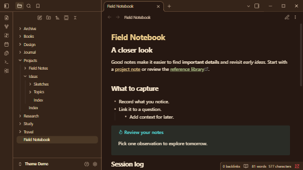
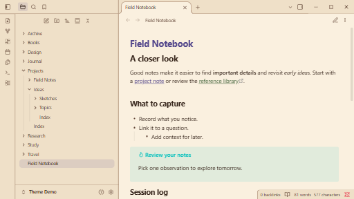

# Coffee Gold

A warm brown Obsidian theme with cream text and muted gold accents.

Source version 3.7.2. Supports dark and light mode and requires Obsidian 1.15.1 or later.
Version 3.7.2 was tested in Obsidian 1.15.1 on Windows. See the [desktop verification report and screenshots](docs/qa/2026-11-24/README.md).

## Preview

## Install manually

1. Download `manifest.json` and `theme.css` from [the latest published release](https://github.com/tutivsoft-com/obsidian-theme-coffee-gold/releases/latest).
2. Put both files in `.obsidian/themes/Coffee Gold/` in your vault.
3. Open **Settings > Appearance** and select **Coffee Gold**. Choose a supported base colour scheme.

## Check the source

With Python 3.10 or later installed, run the stylesheet and contrast tests from the repository root.

~~~sh
python -m pip install tinycss2==1.5.1 cssselect2==0.9.0
python -B -m unittest discover -s tests
~~~

See the [original design plan](PLAN.md). [MIT license](LICENSE).
